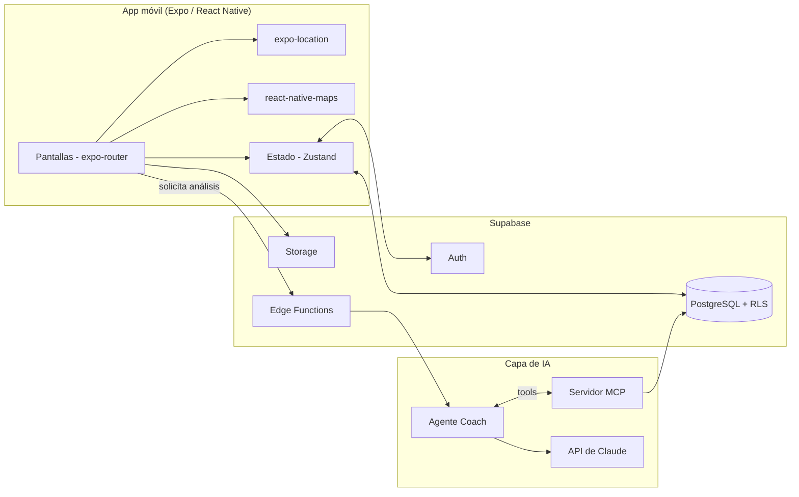

# TrackFit — Especificación del Proyecto (Fase 1)

> **Nota:** "TrackFit" es un nombre provisional. Reemplázalo por el nombre final de tu app.

| | |
|---|---|
| **Materia** | _(completar)_ |
| **Integrantes** | _(completar)_ |
| **Versión** | 1.0 — Fase 1 |

---

## 1. Objetivo de la app

TrackFit es una aplicación móvil multiplataforma (iOS/Android) para registrar actividades físicas al aire libre —correr, caminar y andar en bicicleta— mediante GPS, visualizar el rendimiento del usuario y recibir **asesoría personalizada generada por IA** a partir de su historial.

**Objetivo general:** permitir que un deportista aficionado registre sus actividades, entienda su progreso y reciba recomendaciones de entrenamiento sin necesidad de un entrenador humano.

**Objetivos específicos:**
1. Registrar rutas y métricas de actividades en tiempo real usando el GPS del dispositivo.
2. Almacenar y consultar el historial de actividades de cada usuario de forma segura.
3. Mostrar estadísticas y tendencias de progreso.
4. Integrar un agente de IA que analice el historial y genere resúmenes y planes de entrenamiento.
5. Exponer los datos del usuario mediante un servidor MCP para que agentes de IA puedan consultarlos de forma controlada.

**Usuarios objetivo:** estudiantes y deportistas aficionados que buscan una alternativa sencilla a Strava con un coach inteligente integrado.

---

## 2. Features principales

| # | Feature | Descripción | Prioridad |
|---|---------|-------------|-----------|
| F1 | **Autenticación y perfil** | Registro e inicio de sesión con email/contraseña. Perfil con nombre, foto y estadísticas acumuladas. | Alta |
| F2 | **Tracking GPS de actividades** | Iniciar, pausar y finalizar una actividad. Ruta trazada en el mapa en tiempo real con distancia, tiempo y ritmo/velocidad. | Alta |
| F3 | **Historial y detalle de actividad** | Lista de actividades pasadas; al abrir una se ve el mapa de la ruta, métricas y gráficas (ritmo, elevación). | Alta |
| F4 | **Estadísticas y progreso** | Resumen semanal/mensual: distancia total, tiempo, número de actividades, récords personales. | Media |
| F5 | **Coach IA** | Agente que analiza el historial del usuario, genera un resumen semanal y propone un plan de entrenamiento. Chat para preguntas ("¿cómo mejoro mi ritmo en 5K?"). | Alta |

**Fuera de alcance (posibles fases futuras):** feed social, segmentos/retos, integración con wearables, tracking en background con app cerrada.

---

## 3. Integración con IA / Agentes / MCP

### 3.1 Coach IA (LLM)
- Un modelo de lenguaje (API de Claude) recibe un **resumen estructurado** de las actividades recientes del usuario y devuelve análisis y recomendaciones.
- La llamada al LLM se hace **desde el backend** (Supabase Edge Function), nunca desde la app, para no exponer la API key.
- Casos de uso:
  - **Resumen semanal:** "Corriste 18 km esta semana, 12% más que la anterior…"
  - **Plan de entrenamiento:** genera un plan de 4 semanas según objetivo (ej. 5K en 30 min).
  - **Chat con el coach:** preguntas libres con el historial como contexto.

### 3.2 Servidor MCP (Model Context Protocol)
Se implementará un servidor MCP que expone los datos de TrackFit como herramientas para agentes de IA:

| Tool MCP | Descripción |
|----------|-------------|
| `get_recent_activities` | Devuelve las últimas N actividades del usuario. |
| `get_activity_detail` | Devuelve métricas y splits de una actividad. |
| `get_weekly_stats` | Devuelve estadísticas agregadas por semana. |
| `get_personal_records` | Devuelve mejores marcas (5K, 10K, distancia máxima). |

- El agente Coach usa estas tools para obtener **solo los datos que necesita**, en lugar de recibir todo el historial en el prompt.
- Autenticación: el servidor MCP valida el token del usuario y respeta Row Level Security, de modo que un agente solo accede a datos del usuario autenticado.
- Esto también permite que un cliente externo compatible con MCP (ej. Claude Desktop) consulte los datos del usuario con su permiso.

### 3.3 Uso de IA en el desarrollo
Se usará un asistente de IA como apoyo en generación de código, revisión y documentación, siempre revisando manualmente lo generado antes de hacer commit.

---

## 4. Arquitectura básica

### 4.1 Diagrama



### 4.2 Stack tecnológico

| Capa | Tecnología | Justificación |
|------|-----------|---------------|
| App móvil | Expo (React Native) + TypeScript | Desarrollo rápido, acceso a GPS y mapas, prueba en dispositivo con Expo Go. |
| Navegación | expo-router | Rutas basadas en archivos. |
| Ubicación | expo-location | Tracking GPS en primer plano. |
| Mapas | react-native-maps | Visualización de rutas. |
| Estado | Zustand | Simple y ligero. |
| Backend | Supabase | Auth, Postgres, Storage y Edge Functions sin montar servidor propio. |
| IA | API de Claude + servidor MCP | Coach inteligente con acceso controlado a datos. |
| CI/CD | GitHub Actions | Lint, tipos y validación de commits en cada PR. |

### 4.3 Modelo de datos (inicial)

```
profiles          activities            activity_points
---------         -------------         ----------------
id (PK, = auth)   id (PK)               id (PK)
username          user_id (FK)          activity_id (FK)
avatar_url        type (run/walk/bike)  lat, lng
created_at        started_at            altitude
                  duration_s            recorded_at
                  distance_m
                  avg_speed
                  elevation_gain
```

Todas las tablas usan **Row Level Security**: cada usuario solo puede leer y escribir sus propios registros.

### 4.4 Estructura del repositorio

```
/
├── app/                  # Proyecto Expo
├── docs/                 # Documentación y especificación
├── .github/
│   ├── workflows/ci.yml  # Pipeline CI
│   └── pull_request_template.md
├── commitlint.config.js
├── .env.example
└── README.md
```

---

## 5. Flujo de trabajo y control de calidad

- **Ramas:** `main` (estable, protegida) ← `develop` (integración) ← `feat/*`, `fix/*`.
- **Commits:** [Conventional Commits](https://www.conventionalcommits.org/) (`feat:`, `fix:`, `docs:`…).
- **Pull Requests:** obligatorios hacia `main`, con plantilla y CI en verde.
- **CI:** valida convención de commits, ejecuta ESLint y verifica tipos/sintaxis con TypeScript.

---

## 6. Roadmap

| Fase | Contenido |
|------|-----------|
| **1** | Definición, repositorio, estructura, CI, primer commit. |
| **2** | Autenticación, navegación y pantallas base. |
| **3** | Tracking GPS y mapa en tiempo real. |
| **4** | Historial, detalle y estadísticas. |
| **5** | Coach IA y servidor MCP. |
| **6** | Pulido, pruebas y presentación final. |

## 7. Riesgos

| Riesgo | Mitigación |
|--------|-----------|
| Tracking en background limitado por iOS/Android | Limitar el MVP a tracking con la app en primer plano. |
| Consumo de batería / precisión del GPS | Ajustar `accuracy` y `distanceInterval` de expo-location. |
| Costo de la API de IA | Resumir datos antes de enviarlos; limitar llamadas por usuario. |
| Exposición de secretos | La API key de IA solo vive en el servidor; `.env` en `.gitignore`. |
